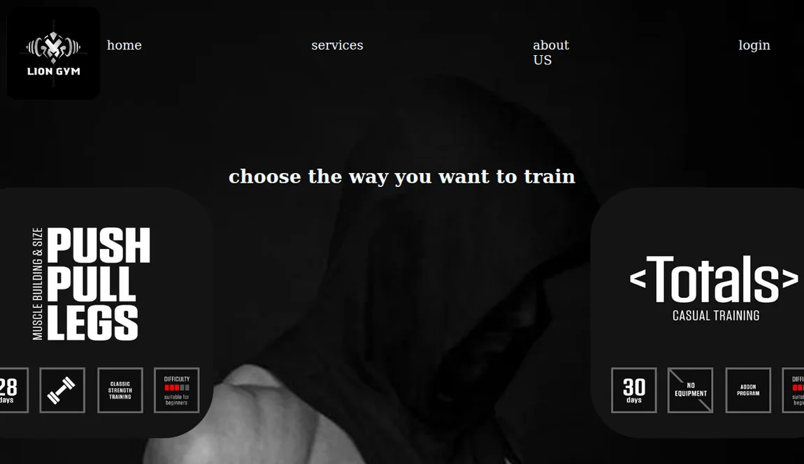

# Lion Gym

A static multi-page gym website built as a frontend practice project. It contains a landing page, service information, workout plans, exercise videos, and sign-in and registration form layouts.

[Open the live demo](https://lion-gym.netlify.app/)



## Run locally

Use Python 3 to serve the project and its bundled media.

```bash
python3 -m http.server 8000
```

Visit `http://localhost:8000`. The sign-in and registration pages demonstrate form layouts. Exercise videos are bundled in the training-day folders, which make up most of the repository download.

**Stack:** HTML, CSS, and vanilla JavaScript.
